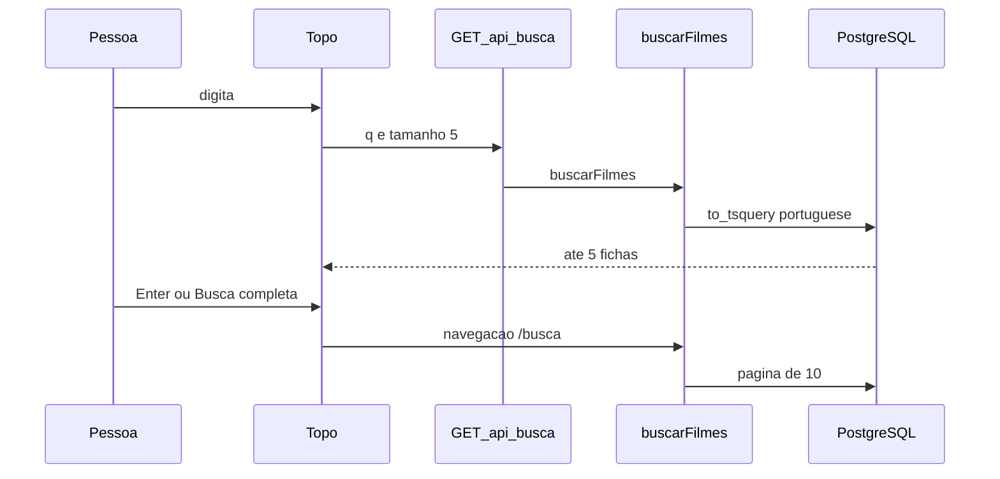

# Busca textual Design

**Spec**: `.specs/features/busca-textual/spec.md`
**Status**: Draft

---

## Architecture Overview

Uma função pura monta o texto, o `tsquery`, a ficha e o corte da página. O PostgreSQL aplica o vetor `portuguese` na hora, sem coluna nova. O painel chama `GET /api/busca`. A página `/busca` chama a mesma função no servidor, atrás de `Suspense`. A raiz não lê a query.

A alternativa de `ILIKE` foi descartada: não é o dicionário `portuguese`. A alternativa de uma coluna `tsvector` com migração foi descartada: o recorte tem dezenas de filmes.



---

## Code Reuse Analysis

### Existing Components to Leverage

| Component | Location | How to Use |
| --- | --- | --- |
| `urlDoPoster` e `formatarDuracao` | `lib/cartaz.mjs` | Banner e duração da ficha |
| `Topo` | `components/topo.tsx` | O campo entra entre o nome e o tema |
| `Suspense` da home | `app/page.tsx` | O filho de `/busca` que lê `searchParams` fica atrás do fallback |
| Cliente Prisma | `lib/prisma.ts` | `$queryRaw` com os parâmetros da consulta |
| Testes `node:test` | `tests/vitrine.test.mjs`, `tests/migracao-filmes.test.mjs` | Função pura no `.mjs` e um teste `pg` contra o banco semeado |

### Integration Points

| System | Integration Method |
| --- | --- |
| PostgreSQL 17 | `to_tsvector('portuguese', titulo \|\| ' ' \|\| titulo_original \|\| ' ' \|\| sinopse)` |
| TMDB images | `next/image` no host `image.tmdb.org`, já permitido em `next.config.ts` |

---

## Components

### texto, tsquery, ficha e recorte

- **Purpose**: Regras que a tela mostra, testáveis sem o banco.
- **Location**: `lib/busca.mjs`
- **Interfaces**:
  - `textoDaBusca(bruto: string): string` - corta em 80, tira o que não é letra ou número
  - `tsqueryDaBusca(texto: string): string` - termos unidos por ` & `, o último com `:*`
  - `fichaDaBusca(linha): { id, titulo, genero, duracao, banner }` - banner, gênero e duração
  - `recorte(total, pagina, tamanho): { pagina, paginas, offset, tamanho }` - 5 ou 10, página inválida vira 1, página alta volta à última
  - `vetorSql: string` - o `to_tsvector` só com as três colunas
- **Dependencies**: `lib/cartaz.mjs`
- **Reuses**: `urlDoPoster`, `formatarDuracao`

### buscarFilmes

- **Purpose**: Conta e devolve a página já ordenada.
- **Location**: `lib/busca-db.ts`
- **Interfaces**:
  - `buscarFilmes({ texto, pagina, tamanho }): Promise<Resultado>` - `vazio`, `nenhum` ou `ok` com `filmes`, `total`, `pagina`, `paginas`
- **Dependencies**: `lib/busca.mjs`, `lib/prisma.ts`
- **Reuses**: o SQL exportado por `lib/busca.mjs`
- **Order**: `ts_rank(...) DESC, f.id ASC`
- **Gênero**: `ORDER BY g.id ASC LIMIT 1`

### GET /api/busca

- **Purpose**: Resposta do painel e, se preciso, da página.
- **Location**: `app/api/busca/route.ts`
- **Interfaces**:
  - `GET(request): Response` - `q`, `pagina`, `tamanho` 5 ou 10; outro tamanho vira 5; falha devolve 500 e `estado: "erro"`
- **Dependencies**: `buscarFilmes`
- **Reuses**: nenhum handler existente; esta é a primeira rota `app/api`

### Campo e painel

- **Purpose**: Busca a cada tecla e o salto para a página.
- **Location**: `components/busca.tsx`
- **Interfaces**:
  - `Busca({ textoInicial, modo })` - `modo` `painel` mostra 5 e o botão; `modo` `pagina` só atualiza `/busca?q=&pagina=1`
- **Dependencies**: `GET /api/busca` no modo painel
- **Reuses**: classes `page-gutter`, `font-display`, `text-stage-ink`, `bg-stage-elev`, `text-brand`

### Topo

- **Purpose**: Colocar o campo entre o nome Catálogo e o botão de tema.
- **Location**: `components/topo.tsx`
- **Interfaces**: o componente atual ganha `<Busca />`
- **Dependencies**: `components/busca.tsx`
- **Reuses**: o header fixo que já existe

### Página /busca

- **Purpose**: Lista de 10 e a paginação.
- **Location**: `app/busca/page.tsx`
- **Interfaces**:
  - filho assíncrono lê `searchParams` `q` e `pagina`, chama `buscarFilmes` com tamanho 10
  - `redirect` quando a página pedida não é a página cortada
- **Dependencies**: `buscarFilmes`, `Topo`, `Busca` em modo `pagina`
- **Reuses**: o `Suspense` de `app/page.tsx`

---

## Data Models

### FichaBusca

```typescript
interface FichaBusca {
  id: number
  titulo: string
  genero: string | null
  duracao: string | null
  banner: string | null
}
```

**Relationships**: uma linha de `filmes` mais o gênero de menor `generos.id`. Sem tabela nova.

### ResultadoBusca

```typescript
interface ResultadoBusca {
  estado: "vazio" | "nenhum" | "ok"
  filmes: FichaBusca[]
  total: number
  pagina: number
  paginas: number
}
```

**Relationships**: `vazio` não consulta o banco. `nenhum` consultou e achou zero. `ok` traz o corte.

---

## Error Handling Strategy

| Error Scenario | Handling | User Impact |
| --- | --- | --- |
| Banco indisponível | A função rejeita; a rota responde 500 | `A busca falhou.` |
| Texto vazio | Retorno `vazio` sem SQL | O painel fecha; a página mostra `Digite um filme para buscar.` |
| Nenhum filme | Retorno `nenhum` | `Nenhum filme para esta busca.` |
| `to_tsquery` inválido | O texto já sai só com letras e números | Não chega operador solto ao PostgreSQL |

---

## Risks & Concerns

| Concern | Location (file:line) | Impact | Mitigation |
| --- | --- | --- | --- |
| Ler a query no servidor suspende a vitrine | `app/page.tsx:11` | A home inteira espera a query | O painel usa `fetch` em `/api/busca`. `searchParams` só no filho de `/busca`, dentro de `Suspense` |
| Pasta de docs do Next vazia neste install | `node_modules/next/dist/docs` | A assinatura de `searchParams` no 16.4.2 não foi lida na doc oficial | Seguir o `Suspense` que a home já usa; se o build reclamar do tipo, ajustar só a assinatura |
| `useSearchParams` no topo | `components/topo.tsx:5` | O topo está na home; o hook suspende a página | O campo da home guarda o texto no estado local |
| Vetor calculado a cada consulta, sem índice | `prisma/schema.prisma:28` | Em um catálogo grande a consulta fica lenta | O recorte atual é pequeno; índice fica fora desta entrega |
| Testes de banco exigem o Postgres semeado | `tests/migracao-filmes.test.mjs:7` | `BUS-15` não roda sem `DATABASE_URL` | O teste de integração segue o mesmo `pg.Client` desses testes |

---

## Tech Decisions

| Decision | Choice | Rationale |
| --- | --- | --- |
| Onde a regra roda | `lib/busca.mjs` e o SQL que ele exporta | Filtro, ordem e contagem ficam numa camada que `node --test` alcança |
| Consulta | `to_tsvector` / `to_tsquery` em `portuguese`, prefixo na última palavra | É a busca textual do experimento, e `hom` precisa casar enquanto se digita |
| Página além do fim | `redirect` para a última `pagina` | A barra de endereço fica igual ao corte mostrado |
| Commits | Nenhum nesta entrega | O pedido proíbe `git commit` |

> **Project-level decisions:** AD-008 em `.specs/project/STATE.md` fixa o vetor textual. A busca por metadados não entra nesse vetor.
