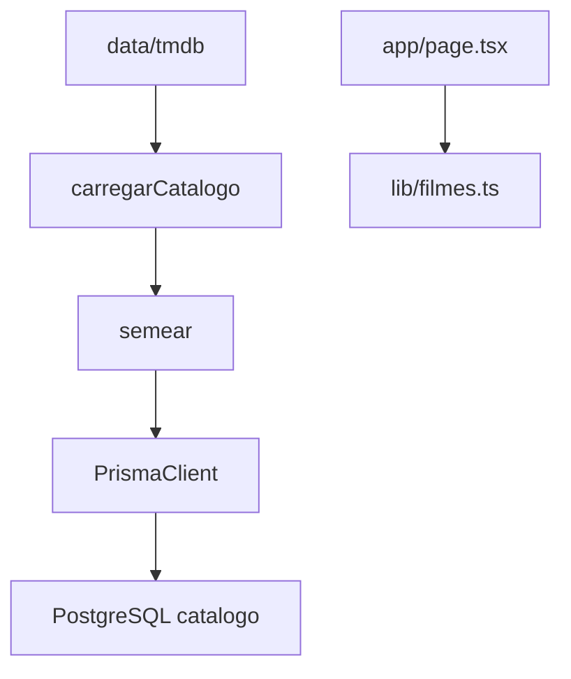

# Catálogo TMDB Design

**Spec**: `.specs/features/catalogo-tmdb/spec.md`
**Status**: Approved

---

## Architecture Overview

O Prisma continua o único caminho de escrita. Uma migração nova substitui a tabela `filmes` vazia. O seed lê `data/tmdb/`, valida o recorte e, só então, abre uma transação que apaga o catálogo e reinsere. A home não entra nesse fluxo.



---

## Code Reuse Analysis

### Existing Components to Leverage

| Component | Location | How to Use |
| --- | --- | --- |
| Cliente Prisma | `lib/prisma.ts` | O seed cria o mesmo `PrismaClient` com `PrismaPg` e `DATABASE_URL`, sem o cache de `globalThis` |
| Teste de banco | `tests/migracao-filmes.test.mjs` | Mesma leitura de `.env` e `pg.Client` |
| Contrato do schema | `tests/schema-contrato.test.mjs` | Mesmo estilo de leitura do arquivo Prisma |
| Config do Prisma 7 | `prisma.config.ts` | Acrescentar `migrations.seed` |

### Integration Points

| System | Integration Method |
| --- | --- |
| PostgreSQL 17 | Migração nova por cima de `20261021154528_init` e `20261021154630_tags_not_null` |
| Prisma 7 | `migrations.seed` = `node prisma/seed.mjs`; `npm run db:seed` chama `prisma db seed` |

---

## Components

### Schema do catálogo

- **Purpose**: Declarar as oito tabelas e retirar `Origem`.
- **Location**: `prisma/schema.prisma`
- **Interfaces**: models `Filme`, `Genero`, `Colecao`, `FilmeGenero`, `Pessoa`, `Elenco`, `Lista`, `ListaFilme`
- **Dependencies**: PostgreSQL
- **Reuses**: generator e datasource já existentes

### Migração `catalogo_tmdb`

- **Purpose**: Derrubar `filmes` e `Origem` e criar as tabelas, sem `INSERT`.
- **Location**: `prisma/migrations/<timestamp>_catalogo_tmdb/migration.sql`
- **Interfaces**: SQL aplicado por `prisma migrate dev`
- **Dependencies**: schema
- **Reuses**: histórico de migrações já aplicado

### Seed

- **Purpose**: Validar e persistir o recorte.
- **Location**: `prisma/seed.mjs`
- **Interfaces**:
  - `carregarCatalogo(raiz): Catalogo` — lê o diretório e lança antes de qualquer escrita
  - `semear(prisma, raiz): Promise<void>` — chama `carregarCatalogo` e só então abre `$transaction`
- **Dependencies**: client gerado e `@prisma/adapter-pg`
- **Reuses**: forma do cliente em `lib/prisma.ts`

Ordem de delete: `listaFilme`, `elenco`, `filmeGenero`, `filme`, `pessoa`, `colecao`, `genero`, `lista`. Insert na ordem inversa. Filme repetido entre listas entra uma vez. Pessoa repetida entre créditos entra uma vez.

---

## Data Models

### Filme

```typescript
interface Filme {
  id: number
  titulo: string
  tituloOriginal: string
  sinopse: string
  tagline: string | null
  dataLancamento: Date
  duracaoMin: number
  popularidade: number
  notaMedia: number
  votos: number
  adulto: boolean
  video: boolean
  softcore: boolean
  idiomaOriginal: string
  imdbId: string | null
  homepage: string | null
  posterPath: string | null
  backdropPath: string | null
  orcamento: number
  receita: bigint
  status: string
  paisesOrigem: string[]
  empresas: unknown[]
  paisesProducao: unknown[]
  idiomas: unknown[]
  colecaoId: number | null
}
```

**Relationships**: N filmes para 1 coleção opcional; N-N com gênero; 1-N elenco; N-N com lista via posição.

### Elenco

```typescript
interface Elenco {
  creditId: string
  filmeId: number
  pessoaId: number
  personagem: string
  ordem: number
  castId: number
}
```

**Relationships**: cada crédito aponta para um filme e uma pessoa. `personagem` vazio permanece `""`.

---

## Error Handling Strategy

| Error Scenario | Handling | User Impact |
| --- | --- | --- |
| Lista sem 20 filmes | `throw` com slug e `20`, antes da transação | O processo do seed termina com erro; as linhas anteriores ficam |
| Elenco ausente | `throw` com `elenco/{id}`, antes da transação | Idem |
| Gênero fora do catálogo | `throw` com o id, antes da transação | Idem |
| Banco fora do ar | O erro do driver sobe | O comando falha; não há arquivo de bloqueio novo |

---

## Risks & Concerns

| Concern | Location (file:line) | Impact | Mitigation |
| --- | --- | --- | --- |
| `tests/migracao-filmes.test.mjs` exige 0 linhas e as colunas do experimento | `tests/migracao-filmes.test.mjs:25` | A suíte quebra assim que o schema muda, e um teste de contagem corre contra o seed | Reescrever o contrato para as colunas novas; a contagem fica só no teste do seed |
| `tests/schema-contrato.test.mjs` exige `Origem`, `tags` e `url_midia` | `tests/schema-contrato.test.mjs:28` | O contrato antigo rejeita o model novo | Trocar as asserções para CAT-01–CAT-10, sem apagar DB-09, DB-10, DB-11 e DB-16 |
| Dois testes escrevendo no mesmo banco | `tests/migracao-filmes.test.mjs:15` | `node --test` corre arquivos em paralelo | Só `tests/catalogo-seed.test.mjs` escreve; a migração só lê `information_schema` |
| Client gerado é TypeScript | `lib/prisma.ts:2` | `node prisma/seed.mjs` pode não importar o client | Confirmar o entry após `prisma generate` e importar o arquivo que o Node executa |

---

## Tech Decisions

| Decision | Choice | Rationale |
| --- | --- | --- |
| Seed | `prisma/seed.mjs` com `carregarCatalogo` e `semear` | O teste chama a função; o CLI chama o mesmo arquivo |
| Nota | `Float` e tolerância `0.000001` | O plano pediu double precision |
| Apagar antes de inserir | `deleteMany` na ordem das FKs | O default do Prisma nas FKs obrigatórias é Restrict |
| Commits | Nenhum nesta feature | Pedido explícito |

> **Project-level decisions:** AD-006 em `.specs/project/STATE.md` substitui, da AD-005, o formato da tabela e a tabela vazia. A home em `lib/filmes.ts` permanece.
